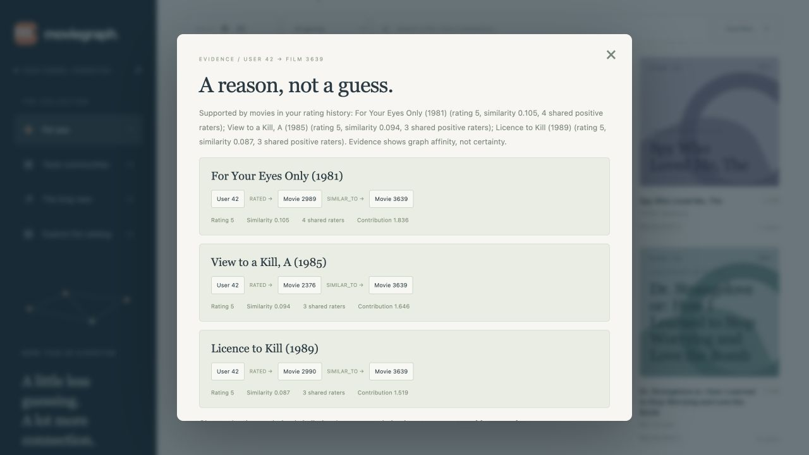

# MovieGraph

**Follow your taste. Find your next story.**

An explainable movie recommendation application built on Neo4j, FastAPI and real MovieLens ratings. Discover similar films, follow taste communities and inspect the exact graph paths behind a recommendation. Natural-language questions use a real local language model, a constrained plan compiler and read-only query templates.

[](https://github.com/canoktayy/moviegraph/actions/workflows/ci.yml)
[](https://github.com/canoktayy/moviegraph/actions/workflows/image.yml)


Project 4, **Movie Recommender in Production — Level 2**, AIDAMS 3A. See the [37-page development guide](proje_guide.pdf) and [requirement/evidence map](docs/requirements.md).

## What works

- Item-based collaborative recommendations that exclude already-rated films.
- GDS Node Similarity, Louvain community discovery and PageRank centrality.
- Verifiable User → RATED → Movie → SIMILAR_TO → Movie explanation paths.
- Searchable catalog, genre filters and a responsive, dependency-free demo interface.
- Authenticated natural language → typed plan → validated Cypher → actual graph rows.
- Idempotent source ingestion, provenance-preserving tag events and versioned analytical runs.
- A frozen-history supervised preference experiment, chronological holdouts and full-catalog ranking evaluation.
- Three healthy Docker services, real Neo4j/Cypher tests, CI, coverage and measured query plans.

## Start here

[Türkçe başlangıç rehberi](docs/START_HERE_TR.md).

Prerequisites: Python **3.12+**, Docker Desktop/Engine with Compose v2, Git and approximately 4–6 GB of Docker memory. Ports are deliberately nonstandard to avoid colliding with other local projects: UI **18080**, Neo4j Browser **17474**, Bolt **17687**. No cloud Neo4j account is required.

```bash
git clone https://github.com/canoktayy/moviegraph.git
cd moviegraph
make install
make setup                 # creates .env with unique secrets; never prints them
make docker-run            # starts Neo4j + API + Nginx
make download
make seed
make analytics
make demo
```

Open [the application](http://localhost:18080), [Swagger](http://localhost:18080/docs) or [Neo4j Browser](http://localhost:17474). Neo4j credentials are the local `.env` values. First-run plugin/image downloads require network access. `make seed` can safely be repeated for the same snapshot; switching datasets requires a separate clean database, not an in-place partial merge.

`make stop` stops this stack without deleting its volumes. `make clean` only removes Python caches. Never use `docker compose down -v` unless intentionally deleting this project's database.

### Local language model

The tested model is **qwen2.5-7b-instruct**, served by LM Studio at `http://localhost:1234/v1`. Load the model, start the LM Studio local server, and make its port reachable from Docker if using `/api/ask` through the container. The container uses `host.docker.internal:1234`; host scripts use `localhost:1234`.

If LM Studio is bound to loopback only, Docker on your platform may not reach it. Use the model server's local-network setting or run `make run` on the host and access port **18081**. Do not expose the model server or this development stack to the public internet. Other OpenAI-compatible servers can be configured through `.env`; no paid provider or key is required for LM Studio.

The demo's access-key field accepts `APP_API_KEY` from your local `.env`. It stays in the current browser tab and is not persisted in localStorage. API keys, Neo4j passwords and `.env` are never committed. The application does **not** replace an unavailable model with a fake rule-based “LLM”; standard graph recommendations continue working while `/api/ask` reports a real error.

### Container image and privacy

The publish workflow builds `ghcr.io/canoktayy/moviegraph:latest` and a commit-SHA tag using GitHub's temporary Actions token. [Package page](https://github.com/users/canoktayy/packages/container/package/moviegraph).

This repository is **private** by owner choice. The image preserves private visibility. It is not presented as meeting the rubric's public-registry criterion: publishing an application image publicly also exposes its embedded code. See [solo/privacy scope](docs/solo-scope.md). The Docker build works independently of registry authentication.

## System architecture


| Service | Responsibility | Access |
|---|---|---|
| Nginx | One HTTP entry point, body/time/rate limits | `127.0.0.1:18080` |
| FastAPI | Contracts, recommendation policy, model adapter, validated queries | internal `api:8000` |
| Neo4j 5.26.0 + GDS 2.13.2 | Source graph, constraints/indexes, persistent analytical output | local Browser/Bolt, internal Docker network |
| Batch CLI | Download, validation, seed, GDS, ML and benchmarks | runs on host or via API image |
| LM Studio | Real local JSON-schema query planning | host port 1234 |

One driver per process; short-lived sessions; materialized results; bounded query timeouts. The API does not run GDS afresh on every request. Live/readiness checks differ: readiness requires an actual database round trip and a seeded dataset. Compose's API healthcheck is process liveness, allowing the initial empty stack to start before `make seed`.

## Graph model and deliberate decisions


| Label | Identity and meaningful properties |
|---|---|
| User | `user_id`; anonymous source identity, not a login |
| Movie | `movie_id`, raw `title`, nullable `year`, IMDb/TMDb identifiers |
| Genre | unique canonical `name` |
| Tag | normalized unique `key`, display text |
| TagApplication | deterministic `application_id`, original text, timestamp, source |
| AnalyticsRun | derived run ID, dataset hash, cutoff, GDS version, status |
| SystemState | operational `key`, snapshot hash, historical `as_of`, active run ID |

Observed relationships: `RATED {score,timestamp,source}`, `IN_GENRE`, `APPLIED`, `ON_MOVIE`, `WITH_TAG`. Derived relationships: `SIMILAR_TO {score,support,run_id,method,computed_at}` and `ANALYZED_IN {community_id,pagerank,vote_count,bayesian_rating}`. These are analytically derived facts, not claims that two movies are objectively equivalent.

**Why this schema?** Genres are shared nodes for traversal/filtering; duplicating them in a property array would create synchronization work. A rating is an edge because its score/time describes a user/movie pair. TagApplication is an event node because two independent User–Tag and Movie–Tag links would lose who tagged which movie and when. The source has no actors/directors, so none are invented to increase label counts. Seven uniqueness constraints and the full-text/year indexes support actual access patterns. Cardinality and rating ranges are additionally checked in import/tests, not falsely attributed to Community constraints.

See [model rationale](docs/adr/001-graph-model.md), [analytics versioning](docs/adr/002-analytics-runs.md), [language safety](docs/adr/003-language-safety.md), [evaluation](docs/adr/004-offline-evaluation.md), and [the required AI baseline comparison](docs/modeling-comparison.md). Editable `.drawio` diagram sources are included.

## Recommendation methods

For two films, `U_i` and `U_j` are users who rated each film ≥4. Similarity is Jaccard multiplied by `support/(support+5)`, with at least three shared positive raters. GDS produces 40 raw candidates; after support/shrinkage the application retains up to 20 per film. This is explicitly a bounded approximation. The graph projection is **Movie→User**, reversing stored RATED direction so GDS compares movies by outgoing user neighborhoods.

Personalized ranking aggregates neighbors of the user's latest 50 positive seed films. Scores are weighted averages of seed ratings. All previously rated candidates are excluded. Scores are rounded before sorting to avoid floating-point noise outranking stronger support; tie-breaks use supporting seeds and stable movie ID. Scores are not confidence probabilities. Sparse histories use a labeled Bayesian-popularity fallback.

Louvain uses a canonicalized undirected movie similarity graph. Opposite top-K edges are merged before projection, preventing doubled weights. Discovery selects unseen candidates in the user's dominant communities. Isolated films remain in the catalog, so aggregate community counts include singleton isolates. PageRank measures graph centrality, not time-sensitive popularity.

`/movies/trending` uses the snapshot's last rating timestamp as `as_of`. MovieLens ends in 2018; **these are historical activity rankings, not today's live trends**. Absence of a rating does not establish dislike or prove a film was never watched.

## API examples

```bash
curl 'http://localhost:18080/api/movies/1/similar?limit=5'
curl 'http://localhost:18080/api/users/42/recommendations?genre=Sci-Fi&limit=10'
curl 'http://localhost:18080/api/users/42/discover?limit=5'
curl 'http://localhost:18080/api/movies/trending?metric=pagerank&limit=5'
curl 'http://localhost:18080/api/movies?q=Toy%20Story&limit=10'
```

Choose a returned movie ID, then inspect `/api/users/42/recommendations/{movie_id}/explanation`. Explanation rows include real source ratings, similarity/support and contributions. The top three paths are displayed; additional contributions may exist. A path means recommendation eligibility, not necessarily membership in every possible top-K result. Already-rated films are explicitly excluded from recommendation evidence.



For natural language, set the local key in your shell (without publishing it):

```bash
curl -X POST http://localhost:18080/api/ask \
  -H 'Content-Type: application/json' \
  -H "X-API-Key: $APP_API_KEY" \
  -d '{"question":"Recommend 5 Sci-Fi movies for user 42","user_id":42,"limit":5}'
```

The response exposes interpreted intent, query hash, compiled Cypher, bound parameters, actual rows, warnings and a trace ID. Supported intents cover similar/recommended/discovered/historical films and explanation paths. Names are resolved through catalog selection; the model may not guess movie IDs. Unknown or missing identities request clarification or return 404/422.

| Status | Meaning |
|---|---|
| 200 | valid response, possibly an explicitly empty list |
| 401 | invalid/missing key for the costly LLM endpoint |
| 404 | unknown user/movie |
| 422 | invalid input, unavailable data, unsafe intent or unvalidated query |
| 429 | per-client model budget exceeded |
| 502 | invalid provider output after one repair |
| 503 / 504 | unavailable dependency / bounded timeout |

### LLM reliability boundary

The LLM outputs a typed QueryPlan. A deterministic compiler selects one exact reviewed Cypher template and binds values; it never interpolates raw model Cypher. Explicit source IDs are resolved independently, unknown fields are forbidden, budgets are capped, EXPLAIN checks syntax and a bounded query executes. General CALL/APOC/file access/mutation is absent from the model language. EXPLAIN and driver READ mode are **not** claimed to be access-control sandboxes. Source credentials remain trusted application secrets in a local development deployment.

Successful questions and rejected mutation attempts are demonstrated in the notebook and [40-case evaluation](artifacts/reports/llm_evaluation.json). The suite distinguishes real local-model cases, deterministic scope/guardrail checks and five injected malformed-provider fixtures. It is a small engineering evaluation, not proof that prompt injection is universally solved.

## Data, license and reproducibility

Source: [MovieLens small](https://grouplens.org/datasets/movielens/), [official README and usage terms](https://files.grouplens.org/datasets/movielens/ml-latest-small-README.html). The tested snapshot contains 610 users, 9,742 movies, 100,836 ratings and 3,683 tag applications.

`make download` stores immutable raw files and the original README under untracked `data/`. `make profile` records SHA-256 per source file, a combined snapshot hash and quality distributions. UTF-8 CSV parsing preserves quoted titles; duplicate rating pairs keep the latest timestamp, conflicting equal-time duplicates abort; exact duplicate tag rows are deduplicated. Missing foreign keys and invalid scores abort rather than silently disappearing. Source-row/batch-count and graph invariants verify the import.

This is an educational/research project. MovieLens data and transformed distributions remain subject to its usage terms; no GroupLens endorsement is implied. Do not assume the code repository's availability grants commercial data rights. Required citation: F. Maxwell Harper and Joseph A. Konstan (2015), *The MovieLens Datasets: History and Context*, [DOI](https://doi.org/10.1145/2827872).

## ML and performance evidence

`make train` runs a chronological frozen-history experiment. G0 uses the earliest ~60%; later ~20/10/10% supply train/validation/test labels. Equal timestamps stay together. Rating-derived features use G0 only; static movie/genre catalog metadata is assumed available, and historical release-time availability is not simulated. Production full-data GDS output is never read. Train-only preprocessing and validation-only hyperparameter selection prevent target leakage. High future ratings are positive, low observed ratings negative, 3.5 excluded; missing pairs are not invented negatives.

The experiment reports average precision, ROC-AUC, F1/confusion matrix, warm/cold cohorts and dummy/movie-mean baselines. Full-catalog Recall@10, NDCG@10, candidate recall and catalog coverage compare a Bayesian baseline with frozen item CF. Global chronology produces heavy cold-start conditions; interpret the cohort counts, not only one headline metric. The classifier is not promoted into serving just because it exists.

`make benchmark` compares actual traversal versus precomputed lookup on the same 30 movie IDs after warm-up. It separately records PROFILE operators/DB hits and top-10 overlap, making the approximation's quality trade-off visible. [Measured results](docs/results.md), [ML report](artifacts/reports/ml_metrics.json), [benchmark](artifacts/reports/benchmark.json), [index plan](docs/evidence/profile-index.json).

## Development commands

| Command | Purpose |
|---|---|
| `make help` | all targets and preconditions |
| `make install setup` | isolated dependencies and local secrets |
| `make docker-run` / `make stop` | start/stop the three services |
| `make download profile seed validate-data` | data provenance and graph invariants |
| `make analytics` | real GDS jobs and atomic run activation |
| `make test` | unit + HTTP + real Neo4j/Cypher/GDS with coverage |
| `make test-unit` | isolated tests, explicitly not full validation |
| `make lint` / `make format` | teacher `.pylintrc`, score ≥9.5 / Black |
| `make train` / `make evaluate` | reproducible offline ML experiment |
| `make benchmark` / `make llm-eval` | actual performance / real local-model evaluation |
| `make demo` | live HTTP smoke checks |
| `make run` | host FastAPI at port 18081 |
| `make clean` | disposable Python caches only |

`make test` fails preflight when Neo4j or seeded data is absent; integration tests are not silently skipped. Coverage enforces ≥60%. CI boots the actual three-service stack, imports the real dataset twice, runs GDS and executes tests. Local model evaluation is separate because hosted CI has no LM Studio GPU/model.

Teacher configuration is preserved in `.pylintrc`; no checks were broadly disabled to improve the score. Its existing disabled docstring warnings do not remove the project's explicit docstring requirement.

## Demonstration and contribution record

Run `make help`, `make lint`, `make test`, `make docker-run`. Open the UI/Swagger, inspect one explanation, then show a real `/api/ask` response and a blocked `DELETE` request. See [demo runbook](docs/demo-runbook.md) and executed [demo.ipynb](demo.ipynb).

Solo contributor: **Can Oktay**. Feature branches and merged PRs document actual work. Self-review observations are not represented as independent peer approval. Group balancing and individual-review rules require instructor interpretation for a solo submission. See [scope](docs/solo-scope.md) and [release evidence](docs/release-checklist.md).

Known limits: historical development dataset, selection-biased implicit relevance, approximate top-K similarity, many sparse/isolated movies, local-only API key protection, pinned legacy projection API, no high-availability/SLA claim, no independently obtained human review, and private image visibility. These are explicit boundaries rather than hidden exceptions.
