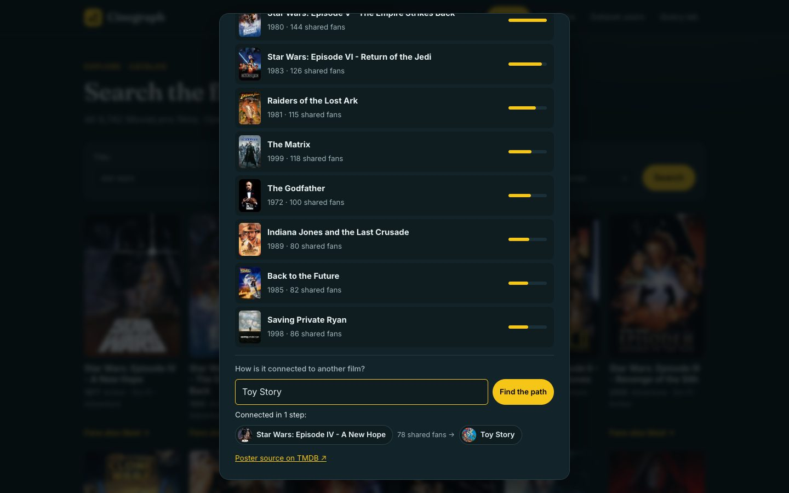
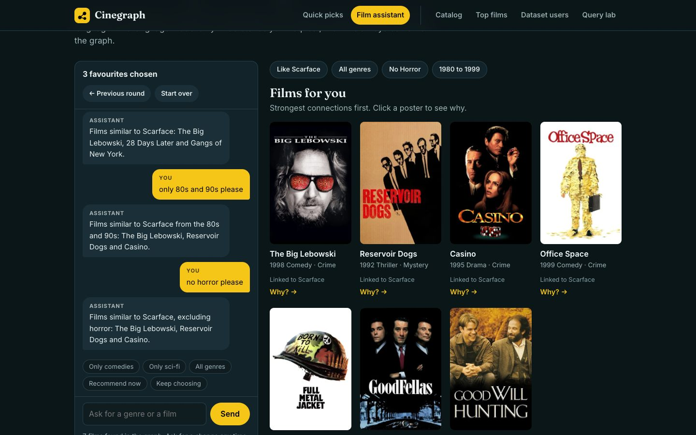
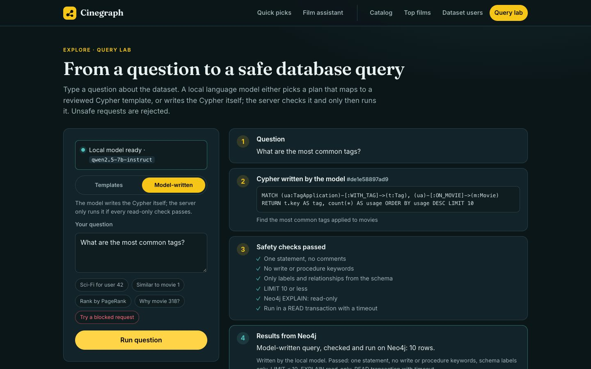
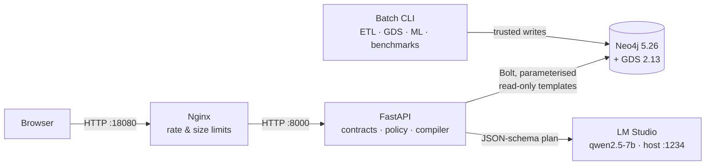
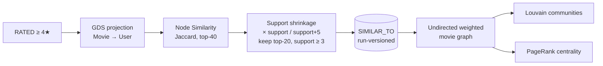
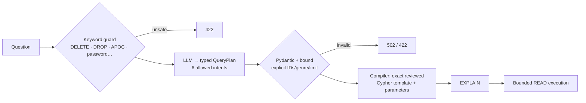
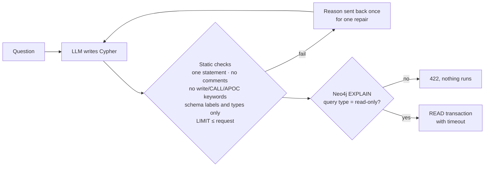
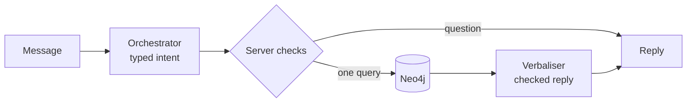

<div align="center">

# 🎬 Cinegraph

### Pick films you love. See what to watch next, and exactly why.

An explainable movie recommender built on a **Neo4j graph** of 100,836 real MovieLens ratings,
with **Graph Data Science** algorithms, a guarded **natural-language → Cypher** lab and a **local-LLM film assistant**.

[](https://github.com/canoktayy/cinegraph/actions/workflows/ci.yml)
[](https://github.com/canoktayy/cinegraph/actions/workflows/image.yml)


**Can Oktay** · Student no. B00818187 · AIDAMS 3A, Graph Databases
Project 4 · *Movie Recommender in Production* (Level 2)


</div>

---

## Contents

1. [What it does](#what-it-does)
2. [Tour of the application](#tour-of-the-application)
3. [Design choices](#design-choices)
4. [Quick start](#quick-start)
5. [Architecture](#architecture)
6. [Graph model](#graph-model)
7. [How recommendations are computed](#how-recommendations-are-computed)
8. [Language-model components and guardrails](#language-model-components-and-guardrails)
9. [API reference](#api-reference)
10. [Quality, evaluation and performance](#quality-evaluation-and-performance)
11. [Commands](#commands)
12. [Repository layout](#repository-layout)
13. [Data sources and attribution](#data-sources-and-attribution)
14. [Limitations](#limitations)

---

## What it does

| | Feature | How it works |
|---|---|---|
| 🎯 | **Quick picks** | Ten rounds of five well-known films; click or press <kbd>1</kbd>–<kbd>5</kbd>. Pick favourites, get matches, filter by genre. No account, no model. |
| 💬 | **Film assistant** | The same flow as a conversation. Say *“Scarface is my favourite film”*, *“only 90s thrillers”* or *“no horror”*: a local LLM understands the request, the graph returns the films, and the LLM describes them. |
| 🔍 | **“Why this film?”** | Every recommendation shows the picks it is linked to and how many raters loved both films. |
| 📚 | **Catalog** | Full-text search over 9,742 films, genre filter, “fans also liked”, and the **shortest connection** between any two films. |
| 🏆 | **Top films** | The highest rated films in the data’s final year (adjusted so a film with few ratings cannot win by luck), or the most connected films by **PageRank**. |
| 👥 | **Dataset users** | Pick any of the 610 anonymous MovieLens raters: see the films they loved, then what the graph recommends for them (similar films, or films from their **Louvain** taste communities) with the exact path behind each one. |
| 🧪 | **Query lab** | Ask a question in plain English. Either the model picks a plan that maps to a reviewed Cypher template, or it writes the Cypher itself and the server proves it read-only before running it. Unsafe requests are rejected with HTTP 422. |

**Design principle:** the language model never invents films, scores or explanations. All titles, counts and paths come from Neo4j and are shown with their provenance.

---

## Tour of the application

### 1 · Quick picks: no setup required

Five films per round, ten rounds. Unpicked films are **not** treated as dislikes.


Results are ranked by how strongly they are linked to your picks. Each genre chip runs the query again in Neo4j.


### 2 · A visible reason for every match

<table>
<tr>
<td width="50%"></td>
<td width="50%"></td>
</tr>
<tr>
<td align="center"><sub>Which of your picks lead to the film, and how many raters loved both</sub></td>
<td align="center"><sub>Any catalog film: neighbours by shared positive raters</sub></td>
</tr>
</table>

**Pathfinding:** in any film’s dialog, type another title to see the shortest chain of “people who loved this also loved that” links between them (`shortestPath` in Neo4j).



### 3 · Film assistant: conversation on top of the graph

The server runs the ten rounds itself. For typed requests the local model works in two layers: an **orchestrator** decides what to run (all favourites or one named film, plus genre, excluded genre and years), the server checks it and runs one graph query, and a **verbaliser** describes the real results in the visitor’s language.



<sub>The visitor wrote “Scarface is my favourite film”, then “only 80s and 90s please” and “no horror please”. Each new filter is added to the ones before, and the chips show exactly what ran.</sub>

### 4 · Explore the data

<table>
<tr>
<td width="50%"></td>
<td width="50%"></td>
</tr>
<tr>
<td align="center"><sub>Top films: Bayesian rating or PageRank centrality</sub></td>
<td align="center"><sub>Recommendations for MovieLens rater 42 (item CF / Louvain)</sub></td>
</tr>
</table>

### 5 · Query lab: natural language to safe Cypher

Two modes. **Templates:** the model picks a plan that maps to a reviewed query. **Model-written:** the model writes the Cypher itself, and it only runs after every read-only check passes, including Neo4j’s own EXPLAIN.

<table>
<tr>
<td width="50%"></td>
<td width="50%"></td>
</tr>
<tr>
<td align="center"><sub>Templates: question → plan → reviewed Cypher → Neo4j rows</sub></td>
<td align="center"><sub>Model-written: the query the model wrote, the checks it passed, the rows</sub></td>
</tr>
</table>

<p align="center"><br><sub>“DELETE all nodes” is rejected before any database call</sub></p>

### 6 · Mobile

<p align="center">


</p>

---

## Design choices

**Name.** *Cinegraph* joins *cinema* and *graph*: the films and the Neo4j graph that connects them. Every recommendation is a path through that graph, from a film you picked, through the people who loved it, to the next film.

**Two colours, teal and IMDb yellow.** The interface uses one dark hue for surfaces and one bright accent for actions, and lets the posters carry every other colour.

| Role | Colour | Why |
|---|---|---|
| Surfaces | Teal-tinted near-black `#0b1619` to `#1a2f37` | Dark, low-saturation surfaces recede, so colourful posters stand out. A tinted dark grey instead of pure black reduces halation of light text, which mostly affects readers with astigmatism. Cool teal backgrounds are also the backdrop of the *orange and teal* look in film colour grading. |
| Actions and highlights | IMDb yellow `#f5c518` | The colour people already associate with film ratings, so buttons, ratings and links read as "film" at a glance. It is warm against the cool teal surfaces. |
| Text | Off-white `#e9f1f1`, muted `#9fb4b7` | Softer than pure white on dark backgrounds. |

**Typefaces.** Headings use [Fraunces](https://fonts.google.com/specimen/Fraunces), a high-contrast optical-size serif with the feel of classic film titles; interface text uses [Inter](https://fonts.google.com/specimen/Inter), designed for screen legibility at small sizes. Both load from Google Fonts with system fallbacks, so the app still works offline.

Measured WCAG contrast on the page background: body text 16:1, muted text 8.5:1, yellow 11.3:1, and black text on yellow buttons 12.9:1, all above the AA threshold of 4.5:1. Sources: [PetaPixel on the orange and teal look](https://petapixel.com/2017/02/23/orange-teal-look-popular-hollywood/), [Adobe on why orange and teal grading works](https://www.adobe.com/creativecloud/video/hub/features/why-use-orange-teal-grading), [overview of polarity and halation research](https://a11ywithdiana.substack.com/p/and).

---

## Quick start

**Requirements:** Python 3.12+, Docker with Compose v2, Git, Node.js 20+ (frontend tests only). Allow 4–6 GB of Docker memory.

```bash
git clone https://github.com/canoktayy/cinegraph.git
cd cinegraph
make install        # virtualenv + pinned dependencies
make setup          # creates an untracked .env with unique secrets (never printed)
make docker-run     # Neo4j + GDS, FastAPI, Nginx; waits until healthy
make download seed  # MovieLens small: download, validate, import
make analytics      # GDS similarity, Louvain, PageRank → versioned run
make demo           # live HTTP smoke checks
```

| Service | URL |
|---|---|
| **Cinegraph** | http://localhost:18080 |
| Swagger / OpenAPI | http://localhost:18080/docs |
| Neo4j Browser | http://localhost:17474 (Bolt `17687`, credentials in your `.env`) |

**Prebuilt image:** `docker pull ghcr.io/canoktayy/cinegraph:latest` ([package page](https://github.com/canoktayy/cinegraph/pkgs/container/cinegraph)). Set `MOVIEGRAPH_IMAGE=ghcr.io/canoktayy/cinegraph:latest` in `.env` to run the published image instead of building locally.

**Optional local model** (Film assistant and Query lab): load `qwen2.5-7b-instruct` in [LM Studio](https://lmstudio.ai) and start its server on port `1234`. No key is needed: the Film assistant and Query lab show a live status (“Local model ready” or how to start it). Everything else works without a model.

A short walkthrough is available in [docs/START_HERE.md](docs/START_HERE.md).

---

## Architecture




| Component | Responsibility |
|---|---|
| **Nginx 1.28** | Single entry point on `18080`; 16 KB body limit, per-IP budgets for model endpoints, timeouts, security headers |
| **FastAPI** | Pydantic contracts, recommendation policy, plan compiler, static frontend; one driver per process, bounded query time |
| **Neo4j 5.26 + GDS 2.13** | Source graph, 7 uniqueness constraints, full-text and range indexes, versioned analytical output |
| **Batch CLI** | Source validation and idempotent import, GDS jobs with atomic activation, offline ML experiment, benchmarks |
| **LM Studio (optional)** | Local, OpenAI-compatible model for intent planning only |
| **Frontend** | Dependency-free HTML/CSS/JS; hash-routed screens, stale-request protection, responsive down to 360 px |

The API never runs GDS per request: it reads the results of the active `AnalyticsRun`. Readiness (`/health/ready`) requires a Neo4j round trip **and** a seeded snapshot; liveness lets an empty install start before import. All three containers have health checks.

---

## Graph model


| Node | Key properties | Meaning |
|---|---|---|
| `User` | `user_id` | Anonymous MovieLens rater |
| `Movie` | `movie_id`, `title`, `year`, `imdb_id`, `tmdb_id` | Catalog film (title is not an identity) |
| `Genre` | `name` | Canonical genre vocabulary |
| `Tag` | `key` | Normalised tag concept |
| `TagApplication` | `application_id`, `raw_text`, `timestamp` | One user tagging one film at one time |
| `AnalyticsRun` | `run_id`, `cutoff`, `gds_version`, `status` | A versioned GDS computation |
| `SystemState` | `data_version`, `as_of`, `active_run_id` | Snapshot identity and the active run |

| Relationship | Properties | Kind |
|---|---|---|
| `(:User)-[:RATED]->(:Movie)` | `score`, `timestamp` | observed |
| `(:Movie)-[:IN_GENRE]->(:Genre)` | none | observed |
| `(:User)-[:APPLIED]->(:TagApplication)-[:ON_MOVIE]->(:Movie)` | none | observed |
| `(:TagApplication)-[:WITH_TAG]->(:Tag)` | none | observed |
| `(:Movie)-[:SIMILAR_TO]->(:Movie)` | `score`, `support`, `run_id` | derived (GDS) |
| `(:Movie)-[:ANALYZED_IN]->(:AnalyticsRun)` | `community_id`, `pagerank`, `vote_count`, `bayesian_rating` | derived (GDS) |

**Key modelling decisions**

- **Genres are nodes**, not a list property: filters and traversals share one canonical vocabulary, and `EXISTS { … }` filtering cannot multiply rating contributions. Keeping both would create two sources of truth.
- **Ratings are relationships**: score and time describe a user–film pair; a `Rating` node would add a hop for no benefit in a latest-rating snapshot.
- **Tag applications are event nodes**: two independent `User–Tag` and `Movie–Tag` edges would lose *who tagged which film, when*.
- **Derived data is versioned**: `SIMILAR_TO` and `ANALYZED_IN` carry a `run_id`; a new run is staged and activated atomically, so a failed job never changes what the API serves.
- **No invented entities**: MovieLens small has no actors or directors, so none are modelled.

Full rationale: [ADR 001: graph model](docs/adr/001-graph-model.md) · [ADR 002: versioned analytics](docs/adr/002-analytics-runs.md) · [anti-genericity comparison with an AI-generated baseline](docs/modeling-comparison.md) · editable [draw.io sources](docs/diagrams/).

### Appendix: our schema vs. a generic AI-generated schema

To check that the model is deliberate and not generic, the same project brief was given to a local LLM (`qwen2.5-7b-instruct`) and its answer was saved unedited in [`modeling-baseline.json`](docs/evidence/modeling-baseline.json). It proposed only `User`, `Movie` and `Genre` with `RATED` and `IN_GENRE`.

| Topic | Generic AI schema | Cinegraph | Why we differ |
|---|---|---|---|
| Identities | `userId`/`movieId` as strings, plus an invented `username` | Integer source IDs with uniqueness constraints; no invented fields | MovieLens has no usernames; titles are not identities (“Scarface” is two films) |
| Tags | Not modelled | `TagApplication` event node linking user, film, tag and time | Two separate User–Tag and Movie–Tag edges would lose who tagged which film, and when |
| Similarity | Computed live from shared genres | Shared positive raters (GDS Node Similarity), shrunk for low support, stored as `SIMILAR_TO` | Genre overlap says *Toy Story* is like every animated film; shared fans capture taste |
| Analytics | Not modelled | `SIMILAR_TO` and `ANALYZED_IN` carry a `run_id`; one `SystemState` points at the active run | A failed GDS job can never leave half-written results in what the API serves |
| Time | Ratings as one undated graph | Snapshot `as_of`; ML features frozen before every label | “Trending” and the ML evaluation would otherwise use the future |
| Language interface | Not addressed | Plans compiled to reviewed templates, or model-written Cypher proved read-only | An LLM must never run unchecked queries |

**Alternatives we considered and rejected**

- **Rating as a node** `(:User)-[:GAVE]->(:Rating)-[:FOR]->(:Movie)`: one more hop on every recommendation query for no benefit, since the snapshot keeps one rating per user and film.
- **Genres as a list property** (or both property and node): faster single-film filters, but two sources of truth and no shared node to traverse through; we keep nodes only and filter with `EXISTS { … }`.
- **Analytics written as `Movie` properties**: simplest, but a new run overwrites the live one; versioned relationships allow atomic switching.
- **Actors and directors from another dataset**: not in MovieLens small; adding them would mean entity matching we could not verify, so they are left out rather than invented.

The full comparison is in [docs/modeling-comparison.md](docs/modeling-comparison.md).

---

## How recommendations are computed



| Use case | Method | Endpoint |
|---|---|---|
| Similar films | Precomputed shrunk-Jaccard neighbours; direct traversal fallback | `GET /api/movies/{id}/similar` |
| Your picks (visitor) | Mean similarity to selected seeds, picks excluded, reasons attached | `POST /api/taste/recommendations` |
| Dataset rater | Item CF over the latest 50 positive ratings, already-rated films excluded; labelled Bayesian fallback | `GET /api/users/{id}/recommendations` |
| Community discovery | Films from the rater’s 3 dominant Louvain communities | `GET /api/users/{id}/discover` |
| Top films | Bayesian average over the last 365 days of data, or PageRank | `GET /api/movies/trending` |
| Explanation | Exact `User-RATED->Movie-SIMILAR_TO->Movie` paths and contributions | `GET /api/users/{u}/recommendations/{m}/explanation` |
| Connection between two films | `shortestPath` over the active run’s `SIMILAR_TO` links (at most 6 hops) | `GET /api/movies/{a}/path/{b}` |

Scores are graph affinities, not predicted stars or probabilities. “Trending” is relative to the snapshot’s last timestamp (September 2018), not today.

**Machine learning.** An offline experiment ([ADR 004](docs/adr/004-offline-evaluation.md)) predicts whether a future observed rating will be ≥ 4★ from graph features frozen at an earlier cutoff (chronological 60/20/10/10 split, no leakage, unrated pairs never used as negatives).

---

## Language-model components and guardrails

Both components use a **local** model through an OpenAI-compatible API with JSON-schema output, temperature 0 and at most one format repair.

### Query lab: two ways to turn a question into Cypher

**1. Reviewed templates (default).**



- The model outputs a **plan**, never Cypher. Templates are matched by exact string against an allow-list.
- User and movie IDs, genres and result counts written in the question are **bound from the text**; the model cannot change them.

**2. Model writes Cypher.** For questions the templates do not cover (“most common tags”, “top genres by number of films”), the model writes the query itself and the server proves it is safe before running it:



- Neo4j’s own planner has the last word: anything it does not classify as read-only (`r`) is refused, even if it slipped past the keyword checks.
- Common to both modes: unknown identities → 404, unsafe or unsupported requests → 422, malformed model output → 502, model offline/timeout → 503/504, budget exceeded → 429. The response shows the Cypher that ran, its parameters, the rows and a trace ID.

### Film assistant: two model layers around one graph query



- **Orchestrator:** returns a typed intent (action, tool, the film title as written, filters). It never returns IDs, films or scores.
- **Server:** uses a film title only if the visitor wrote it, and looks it up in the whole catalog (exact title, else the most rated match). Filters the visitor typed (genre names, “no …”, “80s”, “before 2000”) override the model. A question changes nothing.
- **Verbaliser:** one sentence from the real results. A reply that names other films, lists too many, asks a needless question or uses the wrong language is replaced by a factual template.
- Card clicks never call the model, and picks are re-checked against the seeded rounds, so a client cannot forge preferences. Mutation requests and unsupported data (actors, plots) are rejected before any model call.
- This fixes a real logged bug: *“Scarface is my favourite”* used to return films similar to *The Lion King*, because the model had to pick an ID from the visitor’s picks.

Details: [ADR 003: language safety](docs/adr/003-language-safety.md) · [assistant design](docs/film-assistant.md).

---

## API reference

Interactive documentation: **http://localhost:18080/docs**

| Method | Path | Purpose |
|---|---|---|
| GET | `/health/live` · `/health/ready` | Liveness / readiness (DB round trip + seeded data) |
| GET | `/api/system/status` | Real graph counts and snapshot metadata |
| GET | `/api/genres` | Canonical genres |
| GET | `/api/movies?q=&genre=&year=&limit=&offset=` | Full-text catalog search with pagination |
| GET | `/api/movies/{id}/similar` | Similar films (GDS) |
| GET | `/api/movies/{a}/path/{b}?max_hops=` | Shortest connection between two films (pathfinding) |
| GET | `/api/movies/resolve?title=` | Catalog film for a typed title |
| GET | `/api/movies/trending?metric=rating\|pagerank` | Historical top films / centrality |
| GET | `/api/users/{id}/favorites` | The rater’s own 4★+ ratings (context for their recommendations) |
| GET | `/api/users/{id}/recommendations?genre=` | Item-CF recommendations |
| GET | `/api/users/{id}/discover` | Louvain community discovery |
| GET | `/api/users/{u}/recommendations/{m}/explanation` | Path evidence |
| GET | `/api/taste/rounds?seed=` | Ten seeded rounds of five films |
| POST | `/api/taste/recommendations` | Recommendations from visitor picks |
| POST | `/api/ask` 🔑 | Query lab (`mode`: `template` or `generated`) |
| POST | `/api/assistant/turn` 🔑 | Film assistant turn |

🔑 model endpoints: always rate-limited by Nginx and the API; they additionally require the `X-API-Key` header when the server runs with `REQUIRE_API_KEY=true` (off by default because every port binds to `127.0.0.1`). `GET /api/model/status` tells the interface whether LM Studio answers.

```bash
curl 'http://localhost:18080/api/movies/1/similar?limit=5'
curl 'http://localhost:18080/api/users/42/recommendations?genre=Sci-Fi&limit=10'
curl -X POST 'http://localhost:18080/api/taste/recommendations' \
  -H 'Content-Type: application/json' -d '{"movie_ids":[1,260,296],"limit":8}'
curl -X POST 'http://localhost:18080/api/ask' -H 'Content-Type: application/json' \
  -d '{"question":"Recommend 5 Sci-Fi movies for user 42"}'
```

---

## Quality, evaluation and performance

| Check | Result |
|---|---|
| Python tests (unit, API, real Neo4j/Cypher/GDS integration) | **237 passed** |
| Frontend behavioural tests (Node test runner) | **22 passed** |
| Statement + branch coverage (enforced ≥ 60 %) | **84.6 %** |
| Pylint with the course `.pylintrc` (enforced ≥ 9.5) | **9.90 / 10** |
| Query-lab evaluation: 20 live template cases, 6 live model-written Cypher queries, 10 unsafe, 5 unsupported, 6 injected unsafe Cypher drafts, 5 provider faults | **52 / 52** |
| Assistant evaluation: real model + real Neo4j, 10 rounds, named films, decade and exclusion filters, guards | **23 / 23** |

CI ([Quality workflow](.github/workflows/ci.yml)) starts the real three-service stack, imports MovieLens twice to prove idempotency, runs GDS and the whole suite. Integration tests fail loudly when the database is missing instead of skipping.

**Graph analytics (actual run):** 48,580 positive-rating edges projected · 33,679 `SIMILAR_TO` edges · 2,437 connected films in 11 non-trivial Louvain communities · GDS jobs in 4.9 s.

**Offline classifier (test set, 8,598 future ratings):**

| Model | Average precision | ROC-AUC | F1 |
|---|---:|---:|---:|
| Majority prior | 0.480 | 0.500 | 0.649 |
| Historical movie mean | 0.604 | 0.658 | 0.662 |
| **Graph-feature logistic regression** | **0.617** | **0.669** | **0.677** |

**Query performance** (same 30 films after warm-up; see [`profile-*.json`](docs/evidence/) for `PROFILE` plans):

| Method | p50 | p95 |
|---|---:|---:|
| Direct graph traversal | 21.8 ms | 42.5 ms |
| Precomputed GDS neighbours | **2.6 ms** | **4.2 ms** |

Mean top-10 overlap between the two: 0.97. More detail in [docs/results.md](docs/results.md).

**Page weight:** Nginx gzip plus compact poster metadata (`[file, tmdb_id]` per film) cut the first load from about **3.1 MB to 0.32 MB**. Posters are requested at the size each slot needs (92, 185 or 342 px wide), and static files are revalidated on every visit so a new release is never mixed with stale CSS or JS.

---

## Commands

| Command | Purpose |
|---|---|
| `make help` | List every target |
| `make install` / `make setup` | Virtualenv and dependencies / local secrets |
| `make docker-run` / `make stop` | Start (and wait for health) / stop the stack, keeping data |
| `make download` `make profile` `make seed` `make validate-data` | Data acquisition, quality report, import, graph invariants |
| `make analytics` | GDS Node Similarity, Louvain, PageRank with atomic run activation |
| `make test` | Frontend + Python/HTTP/Neo4j/GDS tests with coverage |
| `make test-unit` / `make test-ui` | Tests without a database / frontend only |
| `make lint` / `make format` | Pylint gate / Black |
| `make train` | Offline ML experiment |
| `make benchmark` | Latency and `PROFILE` capture |
| `make llm-eval` / `make assistant-eval` | Real-model evaluations |
| `make notebook` / `make demo` | Execute `demo.ipynb` / HTTP smoke checks |
| `make clean` | Remove caches only |

---

## Repository layout

```
cinegraph/
├── app/
│   ├── main.py            # FastAPI routes, auth, budgets, error handling
│   ├── models.py          # Pydantic contracts
│   ├── queries.py         # Reviewed Cypher templates
│   ├── repository.py      # Parameterised data access
│   ├── services.py        # Recommendation policy and explanations
│   ├── taste.py           # Visitor quick-pick rounds and ranking
│   ├── agent/             # Query lab (plans, client, compiler, workflow) + film assistant
│   ├── analytics/build.py # GDS jobs with versioned, atomic runs
│   ├── ml/experiment.py   # Leakage-free offline classifier
│   └── static/            # Frontend: index.html, style.css, app.js, assistant.js
├── scripts/               # ETL, setup, benchmarks, evaluations, smoke tests
├── tests/                 # unit · api · integration (real Neo4j) · frontend
├── cypher/                # Readable copies of the main queries
├── docs/                  # ADRs, diagrams, screenshots, evidence, guides
├── nginx/default.conf     # Reverse proxy
├── docker-compose.yml     # neo4j · api · nginx
├── demo.ipynb             # Executed demonstration notebook
└── Makefile
```

Further reading: [requirement-to-evidence map](docs/requirements.md) · [demo runbook](docs/demo-runbook.md) · [reliability review](docs/review.md) · [start here](docs/START_HERE.md).

---

## Data sources and attribution

- **Ratings:** [GroupLens MovieLens small](https://grouplens.org/datasets/movielens/): 610 users, 9,742 movies, 100,836 ratings, 3,683 tag applications (1996–2018). F. Maxwell Harper and Joseph A. Konstan (2015), *The MovieLens Datasets: History and Context*, [DOI 10.1145/2827872](https://doi.org/10.1145/2827872). Used under the [MovieLens terms](https://files.grouplens.org/datasets/movielens/ml-latest-small-README.html); no endorsement implied.
- **Posters:** 9,586 references joined on **both** TMDB and IMDb IDs from the [Full TMDB Movies Dataset](https://www.kaggle.com/datasets/asaniczka/tmdb-movies-dataset-2023-930k-movies); only URLs are stored. Images remain with their rights holders. This product uses TMDB data but is not endorsed or certified by TMDB. Posters are never used for ranking.

Import validation rejects invalid scores, missing foreign keys and conflicting identities; per-file SHA-256 hashes are recorded in [`data_quality.json`](artifacts/reports/data_quality.json).

---

## Limitations

- MovieLens is a historical, selection-biased research sample; “top films” are not live trends.
- Similarity uses a bounded top-K approximation; many catalog films have too few ratings to be connected.
- Visitor picks live only in the browser tab and are never written to the graph.
- The stack is built for one computer: ports bind to `127.0.0.1`. Before exposing it, set `REQUIRE_API_KEY=true` (the interface then asks for the key) and put real authentication in front.
- The repository is private; the container image is public on GitHub Container Registry.

---

<div align="center">
<sub>Built by <b>Can Oktay</b> · Neo4j × MovieLens · AIDAMS 3A</sub>
</div>
