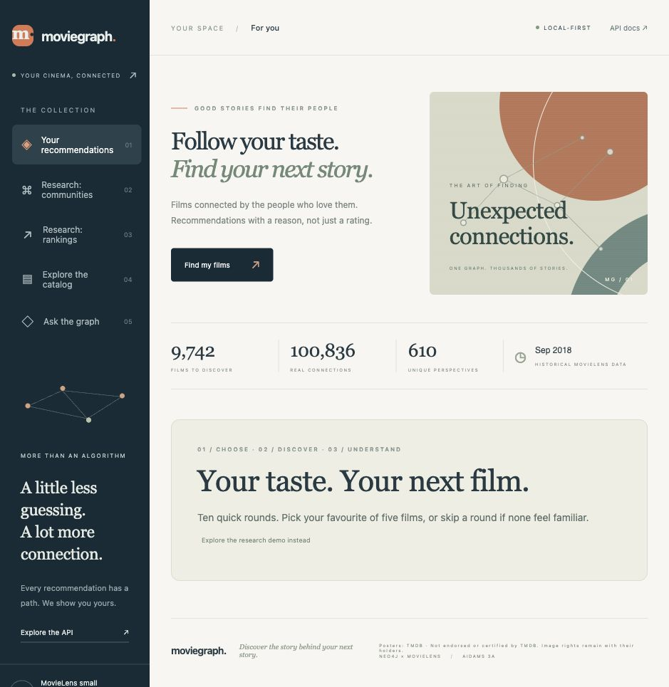
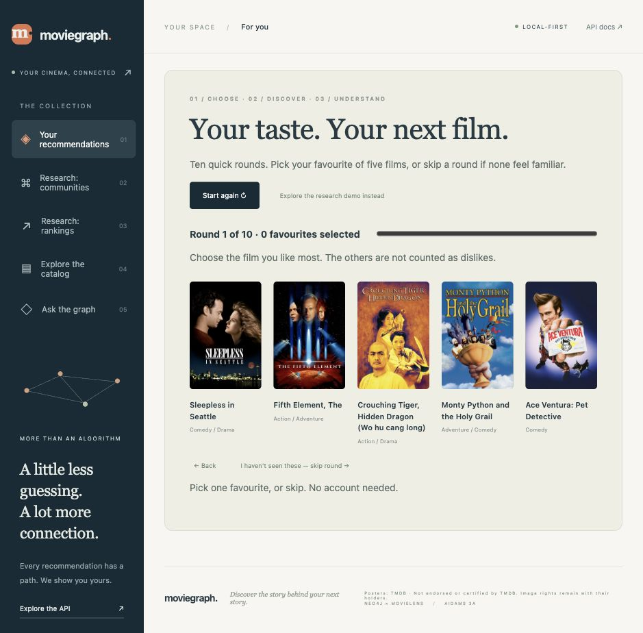
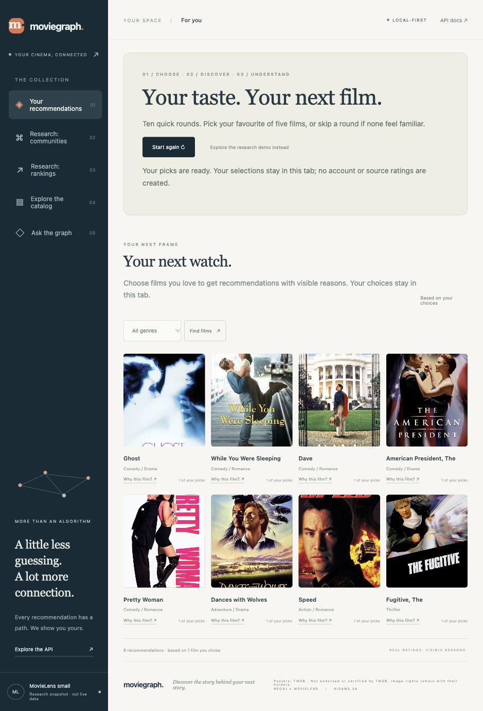
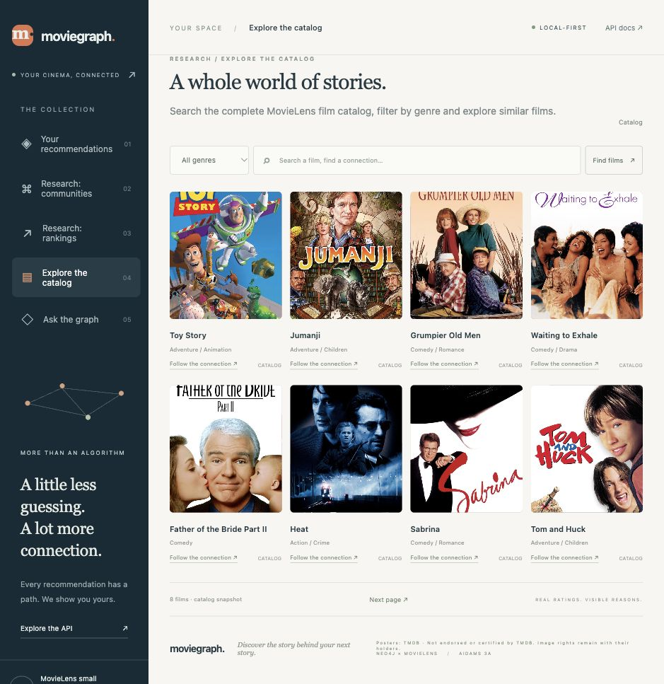
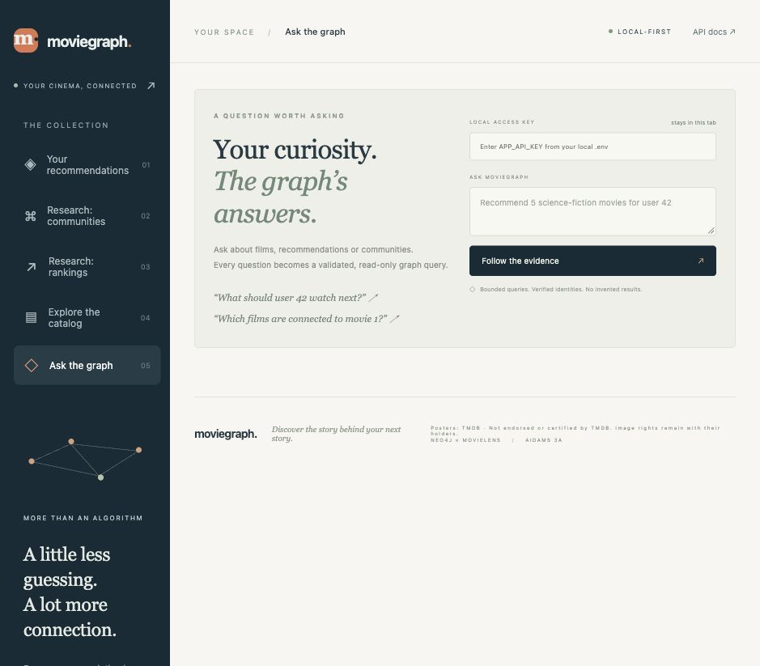

# MovieGraph

**Can Oktay — Öğrenci No: B00818187**

**Follow your taste. Find your next story.**

MovieGraph helps a new visitor find films they might enjoy and understand **why each film was recommended**. Choose a favourite from five films over ten rounds, then explore recommendations connected to your choices through real MovieLens ratings. No account, anonymous user ID or language-model key is needed for personal recommendations.

Project 4 — **Movie Recommender in Production, Level 2**, AIDAMS 3A.

[](https://github.com/canoktayy/moviegraph/actions/workflows/ci.yml)
[](https://github.com/canoktayy/moviegraph/actions/workflows/image.yml)




## Using the application

The sidebar opens **separate screens**. A menu choice changes the active screen instead of scrolling through a long dashboard. The address identifies the screen, browser Back/Forward works, and your quiz progress survives navigation within the page. Reloading clears visitor selections.

| Screen                | What it does                                                                                                                                                         |
| --------------------- | -------------------------------------------------------------------------------------------------------------------------------------------------------------------- |
| Your recommendations  | Start the ten-round quiz, choose or skip films, return to previous rounds, and receive personal recommendations. Open **Why this film?** for the actual connections. |
| Research: communities | Select an anonymous MovieLens user and discover unseen films from their strongest Louvain communities.                                                               |
| Research: rankings    | Inspect historical activity rankings from the snapshot's final year; these are not live trends.                                                                      |
| Explore the catalog   | Search films, filter by genre, change pages and inspect similar films.                                                                                               |
| Ask the graph         | Ask natural-language questions using a local model and inspect the validated query and graph evidence. Requires the local access key.                                |

The **research demo** on the first screen uses an existing anonymous MovieLens user. It is explicitly distinct from recommendations based on your own selections. Source user IDs are dataset identities, not application logins.



Each round offers five different films from a supported 150-film pool; 50 distinct options appear across the quiz. Pick one favourite or skip unfamiliar films. At least one choice is required. Unchosen films are **not** treated as dislikes, and choices do not create fabricated ratings or modify the research graph.



Personal scores combine active graph similarities across all selected films; selected films are excluded from the result. Explanations name the selected seed films, similarity and shared positive raters. Scores are affinities, not predicted stars or probabilities. Preferences stay in page memory; there is no persisted visitor account.



## Run locally

Requirements: **Python 3.12+**, Docker with Compose v2, Git and **Node.js 20+** for frontend tests. Allow approximately 4–6 GB Docker memory. Initial image, plugin and dataset downloads require internet access.

```bash
git clone https://github.com/canoktayy/moviegraph.git
cd moviegraph
make install
make setup
make docker-run
make download
make seed
make analytics
make demo
```

`make setup` creates an untracked `.env` with unique secrets without printing them. Open [MovieGraph](http://localhost:18080), [API documentation](http://localhost:18080/docs) or [Neo4j Browser](http://localhost:17474). Bolt uses port **17687**. Neo4j credentials are in your local `.env`.

The import can be repeated safely for the same snapshot. A different dataset requires a separate clean database. `make stop` stops services while preserving volumes; `make clean` removes Python caches. See the [Türkçe başlangıç rehberi](docs/START_HERE_TR.md).

### Optional local language model

The tested server is **LM Studio**, serving **qwen2.5-7b-instruct** at `http://localhost:1234/v1`. Load the model and start its local server. Containers use `host.docker.internal:1234`, so the server must be reachable from Docker. Alternatively, run `make run` on the host and use port **18081**. Other compatible endpoints can be configured in `.env`.

On **Ask the graph**, enter your local `APP_API_KEY`. It stays in the current tab and is not saved in localStorage. Personal recommendations and graph browsing work independently of the language model. If the model is unavailable, the question endpoint reports a real error rather than substituting a simulated model. This is a local development deployment; do not expose its credentials or development services publicly.



## Data and film images

The recommendation graph uses [GroupLens MovieLens small](https://grouplens.org/datasets/movielens/): **610 users, 9,742 movies, 100,836 ratings and 3,683 tag applications** in the tested snapshot. These are real historical observations, ending in 2018, rather than activity collected from this website.

`make download` preserves raw source files and their README in untracked `data/`. `make profile` records per-file SHA-256 hashes and quality distributions. Import validation rejects invalid scores, missing foreign keys and conflicting source identities. Duplicate rating pairs retain the latest timestamp; conflicting equal-time observations abort. Tag events preserve who tagged which movie and when. `make validate-data` checks graph invariants.

MovieLens use remains subject to the [official usage terms](https://files.grouplens.org/datasets/movielens/ml-latest-small-README.html). Citation: F. Maxwell Harper and Joseph A. Konstan (2015), _The MovieLens Datasets: History and Context_, [DOI](https://doi.org/10.1145/2827872). No GroupLens endorsement is implied.

Film image references are joined using **both exact TMDB and IMDb identifiers** from a frozen [Full TMDB Movies Dataset](https://www.kaggle.com/datasets/asaniczka/tmdb-movies-dataset-2023-930k-movies). There are **9,586 matched references** and 156 designed fallback covers. External URLs can fail; a designed cover remains usable. Recommendations never use TMDB ratings. No TMDB API key is needed for this snapshot.

Only reference metadata is committed, not full image binaries or the third-party CSV. `scripts/fetch_posters.py` is an optional checksum-verified refresh (~638 MiB), not an installation step. See the [image metadata report](artifacts/reports/posters.json). Imagery remains with its rights holders; MovieGraph is not endorsed or certified by TMDB.

## Architecture and graph design


| Component                 | Responsibility                                                               |
| ------------------------- | ---------------------------------------------------------------------------- |
| Nginx                     | HTTP entry point on 18080; body, rate and timeout limits                     |
| FastAPI                   | API contracts, recommendation policy, query compilation and static interface |
| Neo4j 5.26.0 + GDS 2.13.2 | Source graph, constraints/indexes and versioned analytical results           |
| Batch CLI                 | Source validation, import, GDS, ML evaluation and benchmarks                 |
| LM Studio                 | Optional real local-model query planning                                     |

The API reuses one driver per process and short-lived sessions, bounds query time and materializes results. It reads precomputed analytical output instead of rerunning GDS per request. Readiness checks the database and seed; process liveness lets an empty installation start before import.


| Node           | Meaning                                                           |
| -------------- | ----------------------------------------------------------------- |
| User           | Anonymous MovieLens identity                                      |
| Movie          | Film ID, original title, nullable year and external identifiers   |
| Genre          | Shared canonical genre                                            |
| Tag            | Normalized tag identity                                           |
| TagApplication | Provenance-preserving tagging event                               |
| AnalyticsRun   | Dataset hash, cutoff, method version and run status               |
| SystemState    | Snapshot identity, historical timestamp and active analytical run |

Observed edges are `RATED`, `IN_GENRE`, `APPLIED`, `ON_MOVIE` and `WITH_TAG`. Derived `SIMILAR_TO` edges retain score, support and run ID; `ANALYZED_IN` records community, PageRank and rating aggregates. An active run is switched atomically after successful computation.

Genres are shared nodes for traversal. Ratings are edges because score/time belong to a user–movie pair. TagApplication is an event node to avoid losing user/movie/tag/time provenance. Actors and directors are absent from the source and are not invented. Seven uniqueness constraints plus full-text/year indexes support actual access patterns; import/test validation enforces additional cardinality/range rules.

Detailed rationale: [graph model](docs/adr/001-graph-model.md), [versioned analytics](docs/adr/002-analytics-runs.md), [language safety](docs/adr/003-language-safety.md), [evaluation](docs/adr/004-offline-evaluation.md) and [required modeling-baseline comparison](docs/modeling-comparison.md). Editable diagram sources are included.

## Recommendation and query methods

**Movie similarity.** Users rating a film ≥4 form its positive neighborhood. GDS Node Similarity compares Movie→User projections, reversing stored rating direction. Jaccard similarity is shrunk by `support/(support+5)` and requires at least three shared positive raters. Forty raw candidates are reduced to up to twenty retained neighbors per film, making this a bounded approximation.

**New visitors.** Candidate affinity is the sum of similarities to selected films divided by the number of selected seeds. One to ten distinct seeds are accepted. Selected films are excluded; exact supporting seeds accompany the result. This onboarding has functional verification, not a claimed user-study accuracy result.

**Research users.** Item CF aggregates the latest fifty positive source ratings, excludes all already-rated films and uses an explicitly labeled Bayesian-popularity fallback for sparse histories. Louvain discovery uses dominant communities in a canonicalized undirected similarity graph. PageRank measures graph centrality. Singleton isolates remain in the catalog, so aggregate community counts include them. Historical activity uses the snapshot timestamp rather than today's clock.

**Natural language.** A real model produces a typed QueryPlan. A deterministic compiler selects an exact reviewed read-only Cypher template and binds parameters. Explicit identities are resolved independently; unknown fields, unsafe intents and excess budgets are rejected. EXPLAIN validates syntax before bounded execution. Raw model-generated Cypher is never interpolated. Driver READ mode and EXPLAIN are not presented as security sandboxes; application database credentials remain trusted secrets.

## API examples

```bash
curl 'http://localhost:18080/api/taste/rounds?seed=42'
curl -X POST 'http://localhost:18080/api/taste/recommendations' \
  -H 'Content-Type: application/json' \
  -d '{"movie_ids":[1,260,296],"limit":8}'
curl 'http://localhost:18080/api/movies/1/similar?limit=5'
curl 'http://localhost:18080/api/users/42/recommendations?genre=Sci-Fi&limit=10'
curl 'http://localhost:18080/api/users/42/discover?limit=5'
curl 'http://localhost:18080/api/movies/trending?metric=pagerank&limit=5'
curl 'http://localhost:18080/api/movies?q=Toy%20Story&limit=10'
```

Inspect a returned recommendation at `/api/users/42/recommendations/{movie_id}/explanation` to see real rating → similarity paths. Up to three evidence paths are displayed; additional contributions may exist.

```bash
curl -X POST 'http://localhost:18080/api/ask' \
  -H 'Content-Type: application/json' \
  -H "X-API-Key: $APP_API_KEY" \
  -d '{"question":"Recommend 5 Sci-Fi movies for user 42","user_id":42,"limit":5}'
```

Set the shell variable from your local configuration without publishing its value. Responses expose the interpreted intent, compiled query, bound parameters, real rows, warnings and trace ID. Unknown identities return 404; invalid or unsafe input 422; missing model key 401; request budgets 429; malformed model output 502; unavailable or timed-out dependencies 503/504. Valid queries may return an explicitly empty list.

## Validation and evaluation

The recorded local suite passes **154 Python tests and 10 frontend behavioral tests**, with **81.34% Python statement/branch coverage**. Teacher-configured Pylint scored **9.89/10**. Frontend tests cover delayed requests, obsolete errors, closed dialogs, pagination, optional image metadata and screen isolation with quiz preservation. Actual desktop/mobile browser checks complement these simulations.

CI starts the real three-service stack, imports MovieLens twice, runs GDS and executes the suite. Integration tests fail preflight when seeded Neo4j is absent rather than silently skipping. Coverage enforces ≥60%; teacher lint enforces ≥9.5. Local-model evaluation is separate because hosted CI has no LM Studio model.

The [40-case language evaluation](artifacts/reports/llm_evaluation.json) distinguishes actual local-model cases, deterministic guardrails and injected malformed-provider fixtures. All 18 code cells of [demo.ipynb](demo.ipynb) were executed against the configured stack. This is measured engineering evidence, not a universal prompt-injection guarantee.

The supervised experiment uses a frozen chronological graph: earliest ~60% for features, subsequent ~20/10/10% for train/validation/test labels, with equal timestamps kept together. Train-only preprocessing and validation-only tuning prevent target leakage. Production full-data GDS output is not read. Future observed high/low ratings supply labels; missing pairs are not fabricated negatives. Reports include AP, ROC-AUC, F1, confusion matrix and warm/cold cohorts; full-catalog Recall@10/NDCG@10 compare Bayesian and frozen item-CF baselines. The classifier is not automatically promoted into serving.

Benchmarks compare traversal and precomputed lookup on the same thirty movie IDs after warm-up, recording PROFILE operators, DB hits and result overlap. See [measured results](docs/results.md), [ML metrics](artifacts/reports/ml_metrics.json), [benchmark](artifacts/reports/benchmark.json) and [index plan](docs/evidence/profile-index.json).

## Development and demonstration

| Command                            | Purpose                                                |
| ---------------------------------- | ------------------------------------------------------ |
| `make help`                        | Targets and preconditions                              |
| `make docker-run` / `make stop`    | Start/stop services                                    |
| `make profile seed validate-data`  | Data provenance, import and invariants                 |
| `make analytics`                   | Real GDS jobs and run activation                       |
| `make test`                        | Frontend and Python/HTTP/Neo4j/GDS tests with coverage |
| `make test-ui` / `make test-unit`  | Focused frontend / isolated Python checks              |
| `make lint` / `make format`        | Teacher Pylint / Black                                 |
| `make train` / `make evaluate`     | Offline ML experiment                                  |
| `make benchmark` / `make llm-eval` | Query performance / real-model checks                  |
| `make notebook` / `make demo`      | Execute notebook / live HTTP smoke checks              |

For a presentation: complete the quiz, open a recommendation reason, switch to the research and catalog screens, then show a real natural-language query and rejected mutation attempt. Supporting material: [demo runbook](docs/demo-runbook.md), [requirement map](docs/requirements.md), [37-page project guide](proje_guide.pdf) and [review evidence](docs/review.md).

The [container workflow](https://github.com/canoktayy/moviegraph/actions/workflows/image.yml) publishes `ghcr.io/canoktayy/moviegraph:latest` and commit-addressed images. Both the repository and [container package](https://github.com/canoktayy/moviegraph/pkgs/container/moviegraph) remain **private** by owner choice. Public-registry compliance is not claimed. Local Docker builds work without registry authentication.

Solo contributor: **Can Oktay**. Owner reviews are self-reviews, not independent peer approval. Instructor interpretation is needed for group/reviewer requirements; see [solo scope](docs/solo-scope.md). Remaining limits include historical selection-biased data, sparse/isolated movies, approximate similarity, ephemeral visitor preferences and local-development authentication. No live-data, high-availability or guaranteed grading claim is made.
