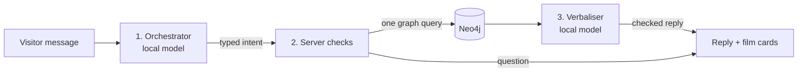

# Film assistant

The film assistant lets a visitor find films by chatting. It shows real films to choose from, then follows requests such as “Scarface is my favourite film”, “only 90s thrillers” or “no horror”. The language model helps understand and phrase things; **every film always comes from the Neo4j graph**.

## How one message is handled



1. **Orchestrator (model).** Reads the message and returns a small typed intent: what to do (`recommend`, `continue_quiz`, `clarify`), which tool to use (`favourites` or `film`), the film title *exactly as the visitor wrote it*, and filters (genre, excluded genre, year range). It never returns film IDs, film lists or scores.
2. **Server checks and runs.**
   - A film title is used only if the visitor really wrote it. The server finds it in the catalog itself: exact title first, otherwise the best match that most people rated (“Star Wars” becomes *Episode IV*, “Scarface” the 1983 film).
   - Filters the visitor typed literally (genre names, “no …”, “without …”, “80s”, “before 2000”) are read by the server and override the model, so a small model cannot flip “no comedy” into “only comedy”. When the visitor types a filter, the filters they did not mention stay as they were.
   - A question (unknown film, vague request) changes nothing: the films on screen stay.
   - Then exactly one parameterised graph query runs: films similar to all favourites, or to the one named film, with the filters applied.
3. **Verbaliser (model).** Writes one short sentence in the visitor’s language from the real results only. The server rejects the reply if it names a film that was not returned, lists more than three results, asks a needless question, uses the wrong language or leaves out the followed film. Then a factual template answers instead. Questions and empty results are always written by the server.

Card clicks (start, choose, skip, back) never call the model: the server runs the ten-round quiz itself, so these steps are fast and cannot claim searches that did not happen.

## The bug this design fixes

Earlier, the model returned a film **ID** and could only choose among the visitor’s picks. When a visitor wrote “Scarface is my favourite film”, Scarface was not among the picks, so the model replaced it with a picked film (*The Lion King*, and once *Heat*) and the server could not tell. Now the model passes the title as text, the server checks that the visitor wrote it and looks it up in the whole catalog. A regression test and the real-model evaluation both cover this case.

## What the visitor sees

- Chips above the results show what ran: *Like Scarface*, *Only Comedy*, *No Horror*, *1980 to 1999*.
- Each card says what it is linked to (*Linked to Scarface* or *Linked to 2 of your picks*), and **Why?** lists the connecting films and how many people loved both.
- *What did the assistant decide?* shows the validated decision and whether the reply came from the model or the template.

Choices, chat and filters live only in the browser tab. Nothing is written to the MovieLens data.

## API

`POST /api/assistant/turn`

```json
{
  "seed": 42,
  "choices": [296, null, 2571],
  "event": "message",
  "message": "Scarface is my favourite film",
  "genre": null,
  "exclude_genre": null,
  "year_from": null,
  "year_to": null,
  "algorithm": "graph_affinity",
  "anchor_movie_id": null
}
```

`choices` has one entry per completed round (a film ID or `null` for a skip); the server rebuilds the seeded rounds and rejects any ID that was not offered. The other fields carry the previous validated plan, so filters and the followed film persist between messages. The response contains `stage` (`choosing`, `recommendations` or `clarify`), `message`, `options` or `items` (each with its graph `reasons`), the validated `plan`, a plain `summary`, and `layers` (which parts used the model).

Errors: 422 for invalid state or input, 502 when the orchestrator returns invalid output twice, 503 when the model server is off, 504 on timeout, 429 when the per-minute budget is used up. Choices are kept for a retry. A key (`X-API-Key`) is required only when the server runs with `REQUIRE_API_KEY=true`.

## Verification

- `make test`: unit tests for every rule above (named film, swapped film, vague film, literal filters, unchanged state on questions, unsafe replies, model outage) plus a real Neo4j test for decade filters and Scarface.
- `make assistant-eval`: the real local model and real Neo4j run ten quiz rounds and ten typed requests, including Scarface, decade and exclusion filters, a title that is not in the catalog and a vague request (23 checks). Results are in [`assistant_evaluation.json`](../artifacts/reports/assistant_evaluation.json).

This is a functional evaluation of the conversation, not a user study of recommendation quality.
