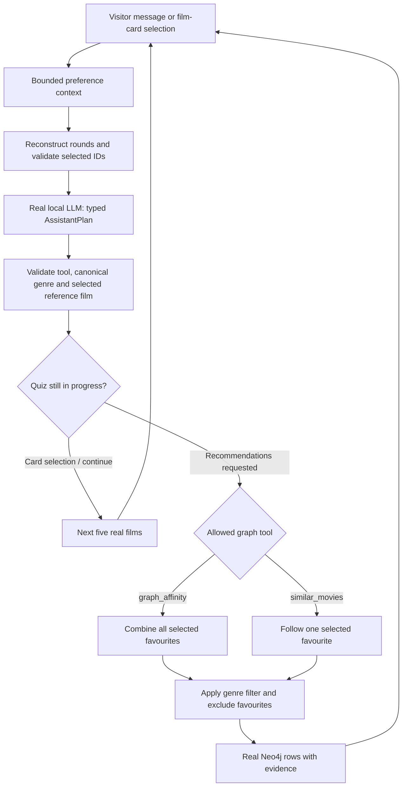

# Conversational film assistant

The navigation has two groups. **Get recommendations** contains **Quick picks** (no language model) and **Film assistant**. **Explore the data** contains **Catalog**, **Top films**, **Dataset users** and **Query lab**, which work on the MovieLens dataset rather than the visitor’s picks.

## Visitor journey

1. Start LM Studio with `qwen2.5-7b-instruct` and the local server on port 1234. Open Film assistant: a status line shows whether the local model answers (`GET /api/model/status`). No key is needed on a local install.
2. Start a conversation. The server shows five real catalog films with a fixed prompt. Choose a card or skip. The server verifies that the chosen ID belongs to that round. Card clicks never call the model.
3. Repeat for ten rounds. Back revisits the previous round. A completed choice is committed in browser state only after a successful response; retry preserves a pending choice when the model is unavailable.
4. The graph algorithm returns recommendations, excluding selected favourites. Open **Why this film?** to see the contributing selected film, shared positive raters and similarity.
5. Send `Bana sadece komedi öner` or `Only comedies, please`. The model chooses the candidate genre filter, and the graph query runs again. `All genres, please` removes the filter. `Recommend now` can request matches before ten rounds when at least one favourite has been selected.
6. Name one selected film to request recommendations similar to that favourite. The tool uses that one seed instead of combining all favourites. Unresolved or unsupported requests ask for clarification rather than inventing a result.

Selected preferences and the transcript stay in browser memory. Reload clears them; navigation between screens preserves them. Starting over clears the conversation. Neither flow creates MovieLens users or ratings. Unselected alternatives are not negative labels.

## Two layers and a fixed quiz controller



The LLM interprets free-text intent and produces a short conversational acknowledgement. It does **not** generate result films, queries or scores. A deterministic controller owns the ten-round sequence: `start`, `pick` and `back` events are answered by the server with factual messages (for example “Added Fargo. Round 4: …”), keep the current tool and filter, and never reach the model. This keeps card clicks fast and prevents the model from claiming searches that did not happen. Only `message` events call the model, which chooses `continue_quiz`, `recommend` or `clarify`.

`graph_affinity` executes the existing parameterized `TASTE_RANKING` query for all selected seeds. `similar_movies` executes the same graph-neighbor retrieval for exactly one validated selected seed. This is an explicit single-favourite mode, not a new trained model or a claim of improved accuracy. Unused single-film fields are normalized away for the all-favourites tool. Other selected favourites are also excluded from the final display, so fewer than eight results can remain.

No generic Cypher executor is exposed. Canonical genres, tool names, identities, input/output sizes and result limits are checked. The model adapter permits one formatting repair. Unsafe mutations and unsupported credits/plot questions fail before model retrieval. Schema validation does not guarantee perfect semantic interpretation; the real-model evaluation records the tested cases rather than claiming universal language understanding.

## API

`POST /api/assistant/turn` (with `X-API-Key` only when the server runs with `REQUIRE_API_KEY=true`):

```json
{
  "seed": 42,
  "choices": [],
  "event": "start",
  "message": "",
  "genre": null,
  "algorithm": "graph_affinity",
  "anchor_movie_id": null
}
```

`choices` contains up to ten entries, one per completed round: a positive strict integer movie ID or `null` for a skipped round. A server-reconstructed seeded offer validates each position. Events are `start`, `pick`, `message` and `back`. Free text is limited to 1,000 characters. The genre, algorithm and anchor carry forward the last validated response. These are bounded stateless context, not a server-stored conversation or a general long-term chat memory.

Responses contain `stage` (`choosing`, `recommendations`, `clarify`), short `message`, `options`, `items`, current/completed round counts, selected IDs/titles, validated `plan`, active analytics run and trace ID. Each recommendation includes actual graph reasons. An empty result remains empty and is explained in the interface; it does not silently switch to invented or unrelated films.

The model endpoint is protected by a 24-turn/minute application budget (plus the optional key described above), with a dedicated Nginx budget and a 70-second proxy timeout for the two bounded provider attempts. The query lab retains its separate proxy budget. The application minute history is shared per client address; multiple local tabs can consume the same budget. A 429 asks the visitor to wait; retries preserve choices. A missing or wrong key on a key-protected server is 401 (the interface then reveals the key field), invalid state/intent 422, invalid model format 502, offline model 503, and model timeout 504. The models and their server must remain locally reachable from Docker.

## Verification

`make test` covers real graph filtering/tool behavior plus isolated provider/HTTP/UI boundary cases. The frontend checks pending-turn serialization, retry state, escaping of model text, and no unexpected route changes after delayed responses.

`make assistant-eval` uses the **actual configured local model and actual seeded Neo4j**, completes all ten rounds deterministically, tests Turkish comedy filtering, a follow-up retaining that filter, clearing the filter, switching to a named selected film, two deterministic scope rejections, and unchanged source cardinalities. The recorded [evaluation](../artifacts/reports/assistant_evaluation.json) separates real-model cases from deterministic guards. It is a small functional evaluation, not a recommendation-quality user study. Existing frozen-history ML and baseline comparisons remain separate.
